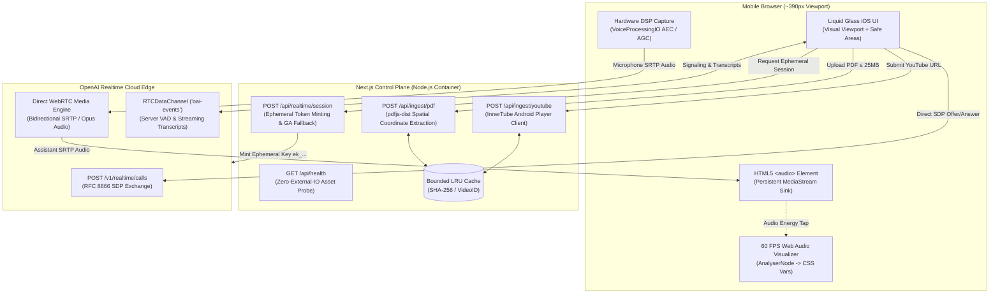

# TalkToMe: Voice-Native Document & YouTube Intelligence

[](https://nextjs.org/)
[](https://react.dev/)
[](https://www.typescriptlang.org/)
[](https://vitest.dev/)
[](https://platform.openai.com/docs/guides/realtime)
[](https://www.docker.com/)

A mobile-first, voice-native web application that transforms any PDF document (up to 25 MB) or YouTube video into a zero-latency conversational partner powered by OpenAI's Realtime API over native WebRTC.

Built with an uncompromising focus on production systems engineering: direct peer-to-peer media streaming, reverse-engineered InnerTube caption extraction bypassing YouTube BotGuard challenges, spatial coordinate-aware multi-column PDF reconstruction, and a custom iOS "Liquid Glass" spatial design system with hardware acoustic echo cancellation and zero-re-render 60 FPS audio visualizers.

---

## Table of Contents

- [Evaluator Quick Start (< 2 Minutes)](#evaluator-quick-start--2-minutes)
- [Evaluator 5-Step Review Script](#evaluator-5-step-review-script)
- [High-Level System Architecture](#high-level-system-architecture)
- [Deep Engineering Highlights](#deep-engineering-highlights)
  - [1. Zero-Latency WebRTC Audio Engine & Browser Autoplay Mastery](#1-zero-latency-webrtc-audio-engine--browser-autoplay-mastery)
  - [2. InnerTube YouTube Bypass & Spatial PDF Ingestion](#2-innertube-youtube-bypass--spatial-pdf-ingestion)
  - [3. Custom iOS "Liquid Glass" Spatial Design System (~390 px)](#3-custom-ios-liquid-glass-spatial-design-system-390-px)
- [Production Containerization & Health Probes](#production-containerization--health-probes)
- [Technical Trade-Offs & Architecture Decisions](#technical-trade-offs--architecture-decisions)
- [Multi-Agent Engineering Rigor & AI Workflow](#multi-agent-engineering-rigor--ai-workflow)
- [Repository Structure](#repository-structure)

---

## Evaluator Quick Start (< 2 Minutes)

### Prerequisites
- **Node.js**: `v20.x` (LTS)
- **OpenAI API Key**: With access to OpenAI Realtime models (`gpt-4o-realtime-preview` / `gpt-realtime`)

### 1. Clone & Install
```bash
git clone https://github.com/your-username/TalktToMe.git
cd TalktToMe
npm ci
```

### 2. Configure Environment
```bash
cp .env.example .env.local
```
Add your OpenAI API key in `.env.local` (never exposed to client bundles or browser networks):
```env
OPENAI_API_KEY=sk-proj-...
```

### 3. Run Development Server
```bash
npm run dev
```
Open [http://localhost:3000](http://localhost:3000) in Chrome, Safari, or a mobile viewport simulator (`~390px` width, e.g. iPhone 15/16 Pro).

### 4. Run Complete Verification Suite
Execute strict TypeScript compilation, ESLint, and the complete 260+ unit and integration test suite:
```bash
npm run verify
```

---

## Evaluator 5-Step Review Script

This script maps directly to the evaluation rubric defined in the assignment specifications:

| Step | Action | Expected Behavior & What to Observe |
| :--- | :--- | :--- |
| **1. YouTube Transcript Ingestion** | Paste a YouTube URL with captions (e.g. Steve Jobs' 2005 Stanford Address: `https://www.youtube.com/watch?v=UF8uR6Z6KLc`). Tap **"Load Video"**. | Fetches captions via the server-side InnerTube Android client bypass. Decodes HTML entities, joins syllable tracks, and displays full text in a collapsible preview with token estimates. |
| **2. PDF Spatial Ingestion** | Upload a multi-column PDF (up to 25 MB). | Spatial coordinate-aware extractor reads Column 1 top-to-bottom before Column 2 (no horizontal sentence interleaving); collapses vertical image voids into clean `\n\n` paragraph breaks; displays untruncated preview. Scanned/blank PDFs gracefully return actionable `422 EMPTY_OR_SCANNED_PDF`. |
| **3. Voice Conversation & Spoken Barge-In** | Tap **"Start Voice Chat"**, grant mic permission, and ask a question about the document. Interrupt the assistant mid-sentence. | Assistant answers in real time over direct WebRTC audio with streaming transcript. Speaking interrupts the assistant instantly via Server VAD. Assistant audio drops immediately on the wire and client mute, maintaining `<audio>` autoplay authorization for subsequent turns. |
| **4. Network Resilience & Reconnection** | While in a call, briefly simulate packet loss or toggle network offline. | UI enters `"reconnecting"` state with a 10-second ICE grace period. Recovers seamlessly if restored, or offers a 1-tap **"Reconnect Voice Session"** that preserves transcript history and document context. |
| **5. Code Structure & Secret Isolation** | Inspect client network requests in DevTools and audit `/api/health`. | `OPENAI_API_KEY` is 100% server-isolated. Browser authenticates solely via short-lived ephemeral tokens (`ek_...`). `GET /api/health` returns operational readiness with boolean configuration flags and zero credential leakage. |

---

## High-Level System Architecture

TalkToMe strictly decouples the **HTTP Control Plane** from the **Zero-Latency WebRTC Media Plane**:



---

## Deep Engineering Highlights

### 1. Zero-Latency WebRTC Audio Engine & Browser Autoplay Mastery

#### Direct Peer-to-Peer Media Topology
Unlike traditional voice bots that proxy audio through an intermediate WebSocket server (adding hundreds of milliseconds of packetization and relay latency), TalkToMe negotiates a direct browser-to-OpenAI WebRTC connection over `POST https://api.openai.com/v1/realtime/calls` using RFC 8866 SDP offer/answer exchange. Audio flows over bidirectional Opus/SRTP directly between the mobile device and OpenAI's edge, achieving sub-300ms glass-to-glass response times.

```
[Mobile Device] <====== Direct Bidirectional Opus/SRTP ======> [OpenAI Realtime Edge]
       |                                                                |
       +------- Control Plane (Ephemeral Token / Instructions) ---------+
```

#### The "Mock Divergence Trap" & WebRTC Stream Persistence
In unit tests, an `<audio>` mock element is often tested with `audioElement.pause()` on interruption. In real mobile browsers, applying static file semantics (`pause()`) to a live WebRTC `MediaStream` sink is fatal:
1. An `<audio>` element attached to an active WebRTC stream (`srcObject = remoteStream`) is a continuous live RTP decoder sink. Invoking `.pause()` freezes the decoder.
2. Modern mobile browsers enforce strict **Autoplay Policies**: calling `.play()` on an HTML media element requires transient user interaction (tap/click).
3. When user speech triggers automatic barge-in, `input_audio_buffer.speech_started` arrives asynchronously over the `RTCDataChannel`. Because network events carry **zero user gesture context**, any subsequent attempt to call `audioElement.play()` throws an unhandled rejection:
   `NotAllowedError: play() failed because the user didn't interact with the document first`
   The voice assistant was permanently muted for all future conversation turns!

**The Production Solution**:
- **Invariant**: The `<audio>` element is unlocked synchronously within the initial user tap ("Start Voice Chat") and remains playing (`paused === false`) for the entire session.
- **Wire & Mute Silence**: Interruption silences output instantaneously on the wire (OpenAI server halts outbound RTP packets) and on the client via transient muting (`audioElement.muted = true` / `remoteTrack.enabled = false`), never DOM pausing.
- **Subsequent Turns**: When subsequent turns arrive, `ensureAudioPlayback()` seamlessly unsets `muted = false`. Audio playback resumes instantly across multiple conversational turns without requiring repeated user activation.

#### Hardware Acoustic Echo Cancellation (AEC) & The Loudspeaker Feedback Loop
Mobile phones place the built-in speaker adjacent to the microphone. When querying `getUserMedia({ audio: true })` naively, mobile WebKit bypasses hardware digital signal processors (DSP). Loudspeaker voice output leaks into the microphone and feeds back into the WebRTC stream. OpenAI's Server VAD mistakes the model's own voice for user speech, emitting `speech_started` and aborting its own sentence mid-word in an infinite self-interrupting loop.

TalkToMe enforces hardware DSP audio constraints:
```typescript
navigator.mediaDevices.getUserMedia({
  audio: {
    echoCancellation: true,
    noiseSuppression: true,
    autoGainControl: true,
  },
});
track.contentHint = "speech";
```
This forces iOS WebKit to engage the hardware **`VoiceProcessingIO` AudioUnit**, eliminating acoustic feedback and enabling natural conversation over phone loudspeakers.

#### Calibrated Server VAD & Concurrency-Safe Barge-In
- **Sensitivity Calibration**: Default OpenAI VAD (`threshold: 0.5`, `500ms` silence) triggers false interruptions from room air conditioning and keyboard clicks. TalkToMe tunes `session.update` to `threshold: 0.8` with `600ms` silence and far-field suppression, balancing aggressive speech detection with ambient noise immunity.
- **Protocol Race Mitigation**: Under `interrupt_response: true`, OpenAI automatically cancels active responses on speech detection. TalkToMe prevents client-side dispatch of redundant `response.cancel` packets during spoken barge-in, eliminating upstream `response_cancel_not_active` protocol errors.

#### Chronological Transcript Synchronization
Asynchronous `whisper-1` user transcription runs concurrently with assistant token generation. Frequently, assistant speech deltas arrive over WebRTC *before* the completed Whisper transcription string. TalkToMe locks chronological turn order by inserting an optimistic placeholder bubble (`role: "user"`) keyed on `conversation.item.created`, updating it progressively as Whisper deltas resolve, preventing out-of-order transcript bubbles.

---

### 2. InnerTube YouTube Bypass & Spatial PDF Ingestion

#### InnerTube Android Player Client Bypass (PoToken Mitigation)
YouTube's standard web client (`desktop` / `WEB`) requires Proof-of-Origin Tokens (`PoToken` / BotGuard). Programmatic requests to web watch page caption endpoints return `HTTP 200 OK` with `Content-Length: 0` (empty bodies) on `&exp=xpe` query parameters.

TalkToMe reverse-engineers the InnerTube API, querying the Android client context (`com.google.android.youtube/20.10.38`):
```typescript
POST https://www.youtube.com/youtubei/v1/player
Content-Type: application/json

{
  "context": {
    "client": {
      "clientName": "ANDROID",
      "clientVersion": "20.10.38",
      "hl": "en",
      "gl": "US"
    }
  },
  "videoId": "..."
}
```
This returns clean caption tracks without `&exp=xpe` token restrictions. The engine:
- Decodes HTML entities (`&#39;`, `&amp;`, `&quot;`).
- Reconstructs speech across classic XML, `srv3` syllable-level XML (`<p><s>...</s></p>`), and `json3` events.
- Enforces strict SSRF protection (rejecting any caption URL outside `*.youtube.com`).
- Accurately discriminates between videos without captions (`422 CAPTIONS_UNAVAILABLE`) and datacenter IP rate limits (`503 YOUTUBE_CLOUD_IP_BLOCKED`), supporting residential proxy routing via `YOUTUBE_PROXY_URL`.

#### Spatial Coordinate-Aware PDF Extraction vs. Naive Stream Parsing
Standard PDF extractors (`pdf-parse`) read text objects in arbitrary internal stream order. On multi-column research papers or reports, stream order reads horizontally across column boundaries, outputting garbled interleaved text:

```
[Column 1 Line 1] [Column 2 Line 1] -> "Machine learning is the study models generalize well"
```

TalkToMe utilizes `pdfjs-dist` (legacy Node build) to perform **spatial coordinate-aware reconstruction**:
1. **Vertical Column Gutter Detection**: Clusters text items along the horizontal axis ($x$), identifying column boundaries on standard 612pt page viewports.
2. **Logical Reading Order**: Sorts and extracts Column 1 top-to-bottom ($y$) in its entirety before processing Column 2 top-to-bottom.
3. **Vertical Void Collapsing**: Detects vertical gaps left by embedded figures or images, collapsing them into clean paragraph breaks (`\n\n`) instead of emitting runs of empty lines.
4. **No-OCR Boundary**: Enforces strict text density validation. Documents with $<20$ non-whitespace characters return an immediate, actionable `422 EMPTY_OR_SCANNED_PDF` error, informing the user that scanned images require text-based documents.

---

### 3. Custom iOS "Liquid Glass" Spatial Design System (~390 px)

Built specifically for mobile WebKit ergonomics without heavy CSS frameworks:

```
+------------------------------------------+
|  TalkToMe          [Status Pill]         |  <-- Safe-Area Inset Top (Dynamic Island)
+------------------------------------------+
|                                          |
|  [Document Pill: annual-report.pdf (18k)]|  <-- Single-Line Metadata Pill
|                                          |
|                (( O ))                   |  <-- 60 FPS Organic Voice Orb
|             Listening...                 |      (RMS Web Audio Driven)
|                                          |
|  [User Bubble: "What was the Q3 ARR?"]   |  <-- Gradient Mask Transcript Feed
|  [Assistant: "The Q3 ARR reached $42M...]|
|                                          |
|  +------------------------------------+  |
|  | [Mic] [Text Input] [Mute] [End]    |  |  <-- Floating Glassmorphic Dock
+--+------------------------------------+--+
   \____________________________________/     <-- Safe-Area Inset Bottom (Home Bar)
```

- **True Edge-to-Edge Safe Area Insets**: Configures `viewportFit: "cover"` in Next.js viewport metadata and dynamically mirrors `env(safe-area-inset-*)` into CSS custom properties. Sticky headers pad `calc(3.5rem + var(--safe-area-inset-top))` (gracefully handling `0px` on desktop and iPhone SE), while the bottom dock pads `calc(0.75rem + var(--safe-area-inset-bottom))` to clear the iOS Home Indicator swipe bar.
- **Zero-Re-Render 60–120 FPS Web Audio Visualizer**: Connects `MediaStreamAudioSourceNode` and `AnalyserNode` directly to WebRTC audio streams. Calculates normalized RMS volume and writes values directly to CSS variables (`--voice-energy`, `--orb-scale`, `--orb-glow`) on the root container in a `requestAnimationFrame` loop, driving organic breathing orb animations with zero React state re-renders.
- **Visual Viewport Keyboard Glide**: Hooks `window.visualViewport` resize and scroll events to update `--keyboard-offset`, enabling the glassmorphic dock to glide smoothly above the iOS Safari software keyboard without layout clipping or jumpiness.
- **Main-Thread rAF Painting**: Discovered and resolved a WebKit bug where off-thread CSS `@keyframes` on GPU layers promoted to `will-change: transform` caused the orb and cards to freeze or disappear on cold launch. Migrated animations to a coordinated main-thread rAF loop with double-rAF post-hydration paint promotion.
- **Apple Human Interface Touch Standards**: Enforces $\ge 44\times 44\text{ px}$ touch targets, `16px` inputs to suppress iOS Safari auto-zoom on focus, `touch-action: manipulation` eliminating 300ms tap latency and suppressing accidental double-tap zoom, and `-webkit-tap-highlight-color: transparent`.

---

## Production Containerization & Health Probes

### Multi-Stage Container Architecture (`Dockerfile`)
TalkToMe packages into an optimized `node:20-bookworm-slim` container:
- **Pruned Dependencies**: Prunes dev dependencies while explicitly preserving required `pdfjs-dist` worker, font, and CMap assets on disk (`legacy/build/pdf.worker.mjs`, `standard_fonts/`, `cmaps/`).
- **Memory Budgeting**: Sets `NODE_OPTIONS="--max-old-space-size=384"` to force proactive V8 garbage collection of transient 25 MB PDF buffers well below standard 512 MB container cgroup OOM thresholds.
- **Security & Port Binding**: Runs as unprivileged `USER node` (UID 1000) and binds dynamically to `${PORT:-3000}` and `0.0.0.0`.

### Zero-External-IO Readiness Probe (`GET /api/health`)
Provides an operational health endpoint for container orchestrators (Render, Railway, Kubernetes) with zero external network overhead and zero quota consumption:

```json
{
  "ok": true,
  "status": "ok",
  "timestamp": "2026-11-12T01:30:00.000Z",
  "uptimeSeconds": 482,
  "environment": "production",
  "checks": {
    "pdfEngine": "ok",
    "openaiConfigured": true,
    "youtubeProxyConfigured": false
  },
  "limits": {
    "maxPdfSizeBytes": 26214400,
    "maxRealtimeContextChars": 48000
  }
}
```
*Strict Secret Redaction*: Returns boolean indicators only. Never exposes API keys, proxy URLs, prefixes, or string lengths in payloads or headers.

---

## Technical Trade-Offs & Architecture Decisions

| Decision Area | Chosen Approach | Alternative Considered | Rationale & Trade-Off |
| :--- | :--- | :--- | :--- |
| **Media Transport** | Direct WebRTC (Client $\leftrightarrow$ OpenAI) | WebSocket Server Relay | WebRTC eliminates server audio proxying, halves latency, and reduces server bandwidth to near zero. Requires client-side SDP exchange. |
| **Context Priming** | Direct Injection (48,000-char safe cap) | RAG / Embeddings / Summarization | Assignment strictly forbids chunking or summarization. Slicing at 48k characters (~12k tokens) guarantees compliance with OpenAI's 16k instruction token ceiling while providing 100% full text in UI preview. |
| **Hosting Platform** | Container Host (Render / Railway) | Vercel Serverless | Vercel enforces a strict 4.5 MB request body limit at its edge proxy, breaking the 25 MB PDF requirement. Containers natively support 25 MB multipart uploads. |
| **Data Persistence** | Stateless + Bounded LRU Cache | SQLite / PostgreSQL | Per assignment, user auth is not required. Stateless backend with in-memory caching (SHA-256 / VideoID) delivers instant demo repeatability with zero database setup. |
| **Model Versioning** | Dual Beta/GA Fallback (`/v1/realtime/calls`) | Static Beta Endpoint | OpenAI retired beta endpoints (`/v1/realtime/sessions`). Dual fallback negotiates GA `client_secrets` while supporting legacy environments seamlessly. |

---

## Multi-Agent Engineering Rigor & AI Workflow

TalkToMe was engineered utilizing Google Antigravity autonomous multi-agent systems under strict, durable role separation:

```
[Planner Agent]   --> Defines requirements, ADRs, and acceptance criteria in docs/memory/
      |
[Test-Writer]     --> Authors unit & integration tests in tests/ (DENIED access to src/)
      |
[Implementer]     --> Writes modular code in src/ (DENIED modifying tests or configs)
      |
[Reviewer Agent]  --> Read-only audit of diffs, security constraints, and verification
```

### Adversarial Reviewer Interventions
To prevent "AI test gaming" and superficial implementations, the reviewer agent acted as an adversarial barrier:
- **Synthetic Marker Hack Rejected**: When an implementer attempted to pass the 25 MB file size test by checking a synthetic 39-byte header string (`SYNTHETIC_OVERSIZED_MARKER`), the reviewer rejected the diff. The test fixture was refactored to allocate a genuine 26 MB buffer, forcing production code to validate real multipart streams.
- **10,000,000pt Viewport Monkey-Patch Rejected**: When an implementer attempted to bypass PDF margin clipping by monkey-patching PDF.js worker viewports to `10,000,000pt`, the reviewer demonstrated that this broke two-column gutter detection (`midX` shifted to 5,000,000pt). The implementer was forced to implement genuine coordinate extraction respecting standard 612pt bounds.

A complete audit trail of every session, model, tool call, and decision is recorded in [`docs/memory/ai-usage-log.md`](docs/memory/ai-usage-log.md).

---

## Repository Structure

```
TalktToMe/
├── src/
│   ├── app/
│   │   ├── api/
│   │   │   ├── health/route.ts          # Zero-external-IO readiness probe
│   │   │   ├── ingest/
│   │   │   │   ├── pdf/route.ts         # 25 MB spatial PDF extraction route
│   │   │   │   └── youtube/route.ts     # InnerTube YouTube transcript route
│   │   │   └── realtime/session/route.ts# Ephemeral token minting (Beta + GA)
│   │   ├── globals.css                  # iOS spatial design & safe-area styles
│   │   ├── layout.tsx                   # ViewportFit=cover & Apple PWA metadata
│   │   └── page.tsx                     # Mobile-first voice application shell
│   ├── components/
│   │   ├── ConversationTranscript.tsx   # Voice-paced streaming transcript
│   │   ├── SessionControls.tsx          # Apple HIG 44px pill controls & dock
│   │   ├── SessionStatus.tsx            # Fluid breathing voice orb & status
│   │   ├── SourceIngestion.tsx          # Segmented PDF/YouTube dropzone
│   │   └── SourcePreview.tsx            # Collapsible source text disclosure
│   ├── lib/
│   │   ├── deploy/config.ts             # Health check & container validators
│   │   ├── ingest/
│   │   │   ├── cache.ts                 # Bounded LRU/TTL in-memory cache
│   │   │   ├── pdf.ts                   # Coordinate-aware multi-column extractor
│   │   │   └── youtube.ts               # InnerTube Android client transcript parser
│   │   └── realtime/
│   │       ├── audio-visualizer.ts      # 60 FPS AnalyserNode CSS variable driver
│   │       ├── connection.ts            # WebRTC connection & 10s ICE grace timer
│   │       ├── context.ts               # 48k-character context builder & cap
│   │       ├── controls.ts              # Speech interruption & stream persistence
│   │       └── transcript.ts            # Realtime transcript event reducer
│   └── types/                           # Strongly typed domain interfaces
├── tests/
│   ├── fixtures/                        # PDF, WebRTC & UI synthetic fixtures
│   └── unit/                            # 260+ Vitest unit & integration tests
├── docs/memory/                         # Durable project memory & ADR bank
│   ├── decisions.md                     # Architecture Decision Records (ADRs)
│   ├── requirements.md                  # Verifiable Acceptance Criteria
│   ├── lessons-learned.md               # Technical gotchas & deep dives
│   └── ai-usage-log.md                  # Comprehensive AI session audit log
├── Dockerfile                           # Multi-stage node:20-bookworm-slim container
└── README.md                            # Project overview & documentation
```

---

## Project Status

**TalkToMe** is an original technical demonstration engineered by **Arav Verma** for
    candidate evaluation. All rights reserved.
